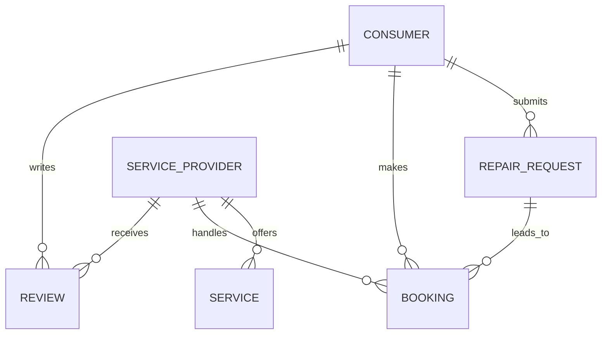

# FixMate — Home Repair Service Management System

<p align="center">
  <strong>Find trusted professionals. Book repairs. Manage services.</strong>
</p>

<p align="center">
  <a href="https://fixmate-llmw.onrender.com">Live Demo</a> •
  <a href="#features">Features</a> •
  <a href="#database-design">Database Design</a> •
  <a href="#sql-and-dbms-concepts">DBMS Concepts</a> •
  <a href="#installation-and-setup">Installation</a>
</p>

---

## 1. Project Overview

**FixMate** is a database-driven home repair service management system developed as a Database Management Systems (DBMS) project. It connects consumers who need household repairs with service providers who offer professional repair and maintenance services.

The application provides a centralized platform to manage users, provider profiles, services, repair requests, bookings, and customer reviews. It uses **Flask** for the application backend and **SQLite** for persistent data storage.

Unlike a static website, FixMate uses a relational database to store and retrieve application data, maintain relationships between entities, and support operations throughout the repair-booking lifecycle.

**Live Application:** https://fixmate-llmw.onrender.com

### Project Details

| Attribute | Details |
|---|---|
| Project Name | FixMate |
| Project Type | DBMS / Web Application |
| Frontend | HTML, CSS, JavaScript |
| Backend | Python, Flask |
| Database | SQLite |
| Database Language | SQL |
| Deployment | Render |
| Architecture | Client–server web application |

## 2. Problem Statement

Finding reliable professionals for household repairs can be inconvenient. Consumers may struggle to identify suitable service providers, compare services, submit repair requests, and keep track of bookings. Service providers also need a way to manage incoming requests and update their booking status.

Managing these operations manually can lead to inconsistent records, duplicated information, and difficulty retrieving booking history.

FixMate addresses these problems by providing a centralized, database-backed platform that organizes consumer information, service-provider details, repair requests, bookings, and reviews.

## 3. Project Objectives

- Develop a functional web application backed by a relational database.
- Implement user registration, authentication, and role-based workflows.
- Maintain structured records for consumers, providers, services, requests, bookings, and reviews.
- Establish relationships between related database entities.
- Support creating, retrieving, and updating application records.
- Enable consumers to discover suitable providers and request repair services.
- Allow providers to manage requests and update booking statuses.
- Demonstrate the practical application of SQL and DBMS principles in a real-world use case.

## 4. Features

### Consumer Features
- Register and log in to the application.
- Browse available home-repair services and service providers.
- View provider profiles and service information.
- Submit repair requests.
- Find suitable providers for requested services.
- Manage and track bookings.
- Submit reviews for service experiences.

### Service Provider Features
- Access a provider dashboard.
- Maintain provider information and service details.
- View incoming repair requests and bookings.
- Update booking status through the provider workflow.

### Database Features
- Store application data in an SQLite relational database.
- Organize information into related entities.
- Retrieve records dynamically for dashboards and service listings.
- Associate requests and bookings with relevant users and providers.
- Store customer reviews and related service information.

## 5. Technology Stack

| Technology | Purpose |
|---|---|
| Python | Application logic and backend programming |
| Flask | Web framework and routing |
| SQLite | Relational database |
| SQL | Database queries and data manipulation |
| HTML | Page structure |
| CSS | Styling and responsive presentation |
| JavaScript | Client-side interactions, where implemented |
| Jinja2 | Dynamic HTML template rendering |
| Werkzeug | Password hashing and authentication utilities |
| Gunicorn | Production WSGI server |
| Render | Cloud deployment |

## 6. System Architecture

FixMate follows a simple three-layer architecture.

```text
          USER
           |
           v
  Web Browser / UI
  HTML, CSS, JavaScript
           |
           v
  Flask Application
  Routes, Validation,
  Authentication, Logic
           |
           v
    SQLite Database
  Persistent Application
          Records
```

**Request flow:**

1. A consumer or provider performs an action through the web interface.
2. The browser sends a request to the appropriate Flask route.
3. Flask processes the request and executes the necessary database operations.
4. SQLite retrieves or modifies the relevant records.
5. Flask returns a rendered page containing the resulting data.

This separation makes the application easier to understand, maintain, and extend.

## 7. Database Design

The database is the core of FixMate. It stores related information in a structured format so that the application can manage repair requests, provider information, bookings, and reviews consistently.

### 7.1 Main Entities

The following are the principal logical entities in the application. Refer to the SQL schema in `app.py` and `DBMS_QUERIES.sql` for the exact table names and columns.

| Entity | Purpose |
|---|---|
| Users / Consumers | Stores consumer account and profile information |
| Service Providers | Stores provider profiles, experience, contact information, and verification details |
| Services | Represents the repair services offered by providers, including categories and pricing |
| Repair Requests | Stores consumers' requests for household repairs |
| Bookings | Tracks the association between repair requests, consumers, providers, and booking status |
| Reviews | Stores customer feedback and ratings associated with completed service experiences |

### 7.2 Relationships Between Entities

The database models relationships between the principal entities:

- **Consumer → Repair Requests:** A consumer can submit multiple repair requests.
- **Service Provider → Services:** A provider can offer one or more services.
- **Repair Request → Booking:** A repair request can be associated with a booking according to the application's booking workflow.
- **Provider → Bookings:** A provider can handle multiple bookings.
- **Consumer → Reviews:** A consumer can submit reviews for service experiences.
- **Provider / Service → Reviews:** Reviews can be associated with the relevant service experience and provider.

These relationships allow the application to retrieve connected information without storing every detail repeatedly in a single table.

### 7.3 Primary Keys and Foreign Keys

A relational database uses keys to identify records and connect related entities.

- **Primary key (PK):** Uniquely identifies each record in a table.
- **Foreign key (FK):** References a record in another table to represent a relationship.
- **Unique constraint:** Prevents duplicate values in columns where uniqueness is required, such as account identifiers.
- **Not-null constraint:** Requires a value for fields that cannot be left empty.

In FixMate, identifiers and relationships help associate consumers with their requests, providers with their services, and bookings with the relevant participants.

The exact constraints enforced by the application should be verified against the database schema.

### 7.4 Conceptual ER Model



This diagram illustrates the conceptual relationships. It is not a substitute for the actual table-level schema; cardinalities and optional relationships should be aligned with the implemented database.

## 8. SQL and DBMS Concepts

FixMate demonstrates how database concepts support a practical application rather than existing only as isolated SQL exercises.

### 8.1 Data Definition Language (DDL)

DDL commands define and modify the database structure.

Examples include:

```sql
CREATE TABLE example (
    id INTEGER PRIMARY KEY,
    name TEXT NOT NULL
);
```

```sql
ALTER TABLE example
ADD COLUMN description TEXT;
```

**Application:** Creating and evolving the tables required to store users, services, requests, bookings, and reviews.

The second statement is an illustrative SQL example; it is not necessarily part of the application's initialization code.

### 8.2 Data Manipulation Language (DML)

DML commands create, modify, and remove records.

```sql
INSERT INTO example (name)
VALUES ('Sample Record');
```

```sql
UPDATE example
SET name = 'Updated Record'
WHERE id = 1;
```

```sql
DELETE FROM example
WHERE id = 1;
```

**Application:** Registering accounts, storing service information, creating repair requests, and updating booking information.

### 8.3 Data Query Language (DQL)

`SELECT` retrieves information from the database.

```sql
SELECT *
FROM example;
```

**Application:** Fetching service listings, provider information, consumer requests, bookings, and dashboard records.

### 8.4 Joins

Joins combine related records from multiple tables using matching columns.

```sql
SELECT
    b.id AS booking_id,
    c.name AS consumer_name,
    p.name AS provider_name
FROM bookings AS b
JOIN consumers AS c
    ON b.consumer_id = c.id
JOIN service_providers AS p
    ON b.provider_id = p.id;
```

This illustrates how a booking report can combine information about consumers, bookings, and providers.

**DBMS significance:** Joins make it possible to store information in related tables and retrieve a meaningful combined result when required.

*Note: Adjust table and column names in this illustrative query to match the actual schema.*

### 8.5 Aggregate Functions

Aggregate functions summarize multiple rows.

```sql
SELECT COUNT(*) AS total_bookings
FROM bookings;
```

```sql
SELECT provider_id, COUNT(*) AS booking_count
FROM bookings
GROUP BY provider_id;
```

Useful aggregate functions include:

- `COUNT()` — counts records.
- `SUM()` — calculates a total.
- `AVG()` — calculates an average.
- `MIN()` — finds the minimum value.
- `MAX()` — finds the maximum value.

**Application:** These operations can support reports such as total bookings, provider-wise request counts, and service statistics.

### 8.6 GROUP BY and HAVING

`GROUP BY` organizes records into groups, while `HAVING` filters groups after aggregation.

```sql
SELECT provider_id, COUNT(*) AS total
FROM bookings
GROUP BY provider_id
HAVING COUNT(*) > 2;
```

This example identifies providers associated with more than two bookings.

### 8.7 Subqueries

A subquery is a query nested inside another SQL statement.

```sql
SELECT *
FROM services
WHERE price > (
    SELECT AVG(price)
    FROM services
);
```

This example retrieves services priced above the average price across the table.

### 8.8 Database Integrity

Database integrity helps maintain valid and consistent records.

- Primary keys identify records uniquely.
- Foreign keys represent relationships between records.
- Appropriate constraints prevent invalid data.
- Validation in the application helps reject incomplete or unsuitable input.
- Consistent relationships reduce orphaned records and data anomalies.

### 8.9 Normalization

Normalization organizes data to reduce unnecessary duplication and modification anomalies.

For example, provider details and service details can be represented separately, with a relationship connecting a provider to the services they offer. This avoids repeating all provider information for every service.

A formal claim that the database satisfies a particular normal form, such as 3NF, should be supported by the actual functional dependencies and schema.

### 8.10 CRUD Operations

CRUD stands for Create, Read, Update, and Delete.

| Operation | Meaning | Example in FixMate |
|---|---|---|
| Create | Add a record | Register a user or submit a repair request |
| Read | Retrieve records | View providers or bookings |
| Update | Modify a record | Update booking status or profile information |
| Delete | Remove a record | Remove a record where deletion is supported |

Together, these operations form the foundation of database-backed applications.

## 9. Application Workflow

### Consumer Workflow

```text
Register / Log In
       |
       v
Browse Services
       |
       v
Submit Repair Request
       |
       v
Find Suitable Provider
       |
       v
Create / Manage Booking
       |
       v
Review Service Experience
```

### Provider Workflow

```text
Log In
   |
   v
Open Provider Dashboard
   |
   v
View Requests / Bookings
   |
   v
Update Booking Status
```

These workflows connect the user interface to database operations and show how records move through the application's service lifecycle.

## 10. Project Structure

The repository is organized around the Flask application, templates, static assets, database initialization, and supporting SQL files.

```text
FixMate/
├── app.py
├── requirements.txt
├── DBMS_QUERIES.sql
├── seed_mock_providers.py
├── templates/
├── static/
├── .gitignore
└── README.md
```

- `app.py` — Flask application, routes, and database operations.
- `requirements.txt` — Python dependencies.
- `DBMS_QUERIES.sql` — SQL queries prepared for the DBMS project.
- `seed_mock_providers.py` — Script for adding demonstration provider records.
- `templates/` — HTML templates rendered by Flask.
- `static/` — CSS, JavaScript, and other static assets.
- `.gitignore` — Excludes files that should not be committed, such as the local database and virtual environment.
- `README.md` — Project documentation.

## 11. Installation and Setup

### Prerequisites

- Python 3.10 or a compatible Python version.
- Git.
- A terminal or command prompt.

### Step 1: Clone the Repository

```bash
git clone https://github.com/dhruvshah25-sys/FixMate.git
cd FixMate
```

### Step 2: Create a Virtual Environment

**Windows PowerShell:**

```powershell
python -m venv venv
.\venv\Scripts\Activate.ps1
```

If PowerShell blocks activation, use Command Prompt instead:

```bat
venv\Scripts\activate.bat
```

### Step 3: Install Dependencies

```bash
pip install -r requirements.txt
```

### Step 4: Configure the Application

Configure a suitable Flask secret key through an environment variable if the application supports it.

For PowerShell:

```powershell
$env:SECRET_KEY = "replace-with-a-random-secret"
```

Do not use a public example secret key in a production deployment.

### Step 5: Initialize and Run

The application initializes its SQLite database through its database initialization code.

Start the development server:

```bash
python app.py
```

Open the local URL shown in the terminal, typically:

```text
http://127.0.0.1:5000
```

### Optional: Add Demonstration Providers

If the demo database needs provider records, run:

```bash
python seed_mock_providers.py
```

Run this from the project directory and only when you intend to populate the local database with demonstration data.

## 12. Deployment

FixMate is deployed using Render.

**Live URL:** https://fixmate-llmw.onrender.com

The deployment uses Gunicorn to serve the Flask application.

Typical deployment settings:

| Setting | Value |
|---|---|
| Build command | `pip install -r requirements.txt` |
| Start command | `gunicorn app:app` |
| Application entry point | `app.py` |
| WSGI application object | `app` |

**Database note:** The application uses SQLite, which stores data in a local database file. On hosting environments where the filesystem is ephemeral, stored records may be lost during a restart or redeployment. Persistent data requires an appropriate persistent storage configuration or migration to a managed database.

## 13. Testing and Validation

The application can be evaluated using the following test scenarios:

- Register a new consumer account.
- Log in with valid credentials and verify invalid-login handling.
- Browse the available providers and services.
- Submit a repair request and verify that it is stored.
- Check whether the appropriate provider and booking information is displayed.
- Update a booking through the provider workflow.
- Submit a review through the supported review workflow.
- Inspect the database to verify that records and relationships are maintained.
- Test validation for missing or invalid form inputs.

For database-level validation, use the SQL queries in `DBMS_QUERIES.sql` and verify their results against the current schema and stored records.

## 14. Security and Limitations

- Passwords should be stored using secure password hashing rather than plaintext.
- The Flask secret key should be kept outside publicly committed source code.
- Database operations should use parameterized queries to reduce SQL injection risk.
- User permissions should be checked before allowing access to protected actions.
- Demonstration accounts and mock provider data should not be treated as real service-provider verification.
- SQLite data stored on an ephemeral deployment filesystem is not guaranteed to survive restarts or redeployments.

## 15. Future Enhancements

Potential extensions include:

- Migration to PostgreSQL for persistent, production-oriented database hosting.
- Provider availability and scheduling management.
- Advanced filtering by service category, location, price, and ratings.
- Notifications for request and booking status changes.
- Payment integration and invoice generation.
- Administrative dashboards and provider verification workflows.
- Analytics for booking volume, provider performance, and service demand.
- Automated database tests and more comprehensive access-control checks.

## 16. Learning Outcomes

This project demonstrates the practical connection between database theory and application development.

Key learning areas include:

- Designing a relational data model for a real-world problem.
- Using SQL to store and retrieve application data.
- Understanding primary keys, foreign keys, and entity relationships.
- Applying CRUD operations in a web application.
- Retrieving related information through relational queries.
- Understanding the importance of data integrity and normalization.
- Integrating a relational database with a Python backend.
- Deploying a database-backed application to a cloud platform.

## 17. Conclusion

FixMate demonstrates how DBMS concepts can be applied to a practical home-repair service management problem. By combining Flask with SQLite, the project brings together structured data storage, related entities, database operations, authentication, service requests, bookings, and reviews in a working web application.

The project provides a foundation for further exploration of relational database design, SQL querying, integrity constraints, and full-stack application development.

---

**Developed as a DBMS academic project.**

**Live Demo:** https://fixmate-llmw.onrender.com

**Repository:** https://github.com/dhruvshah25-sys/FixMate
